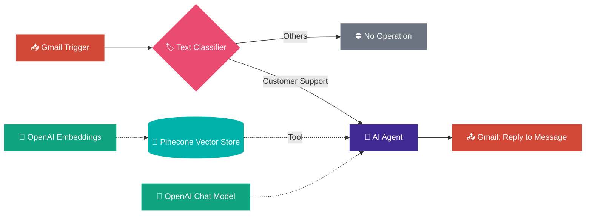

# 🤖 AI Customer Support Agent

### Automated Gmail Support Replies using n8n, OpenAI & Pinecone RAG

**An intelligent email assistant that reads, understands, and replies to customer queries — 24/7, with zero manual effort.**

---

## ✨ Overview

This project is a **fully automated customer support workflow** built in **n8n**. Whenever a new email lands in Gmail, the workflow:

1. 📥 Detects the email
2. 🧠 Classifies whether it is a real support query
3. 📚 Searches a **Pinecone knowledge base** for accurate answers (RAG)
4. ✍️ Generates a professional reply with an **AI Agent**
5. 📤 Sends the reply in the **same email thread**

> 💡 Spam and general notifications are filtered out automatically, saving API cost and avoiding unwanted replies.

---

## 🖼️ Workflow Preview

<!-- Add your n8n workflow screenshot at docs/workflow.png -->

---

## 🏗️ Architecture

---

## 🔍 Workflow Breakdown

| Step | Node | What it does |
|:---:|---|---|
| 1️⃣ | **📥 Gmail Trigger** | Watches the inbox for new unread emails and extracts sender, body, and thread data |
| 2️⃣ | **🏷️ Text Classifier** | Uses an OpenAI model to sort emails into *Customer Support* or *Others* |
| 3️⃣ | **⛔ No Operation** | Catches spam / general notifications so no API calls or replies are wasted |
| 4️⃣ | **🤖 AI Agent** | Support assistant with a system prompt for brand voice and formatting; uses Pinecone as a tool |
| 5️⃣ | **🌲 Pinecone Vector Store** | RAG engine — semantic search over FAQs and docs for grounded, hallucination-free answers |
| 6️⃣ | **🔢 Embeddings OpenAI** | Converts documents and queries into vectors |
| 7️⃣ | **📤 Gmail Reply** | Sends the AI-generated answer back inside the original thread |

---

## 🛠️ Tech Stack

| Category | Technology |
|---|---|
| ⚙️ **Orchestration** | [n8n](https://n8n.io/) (cloud or self-hosted) |
| 🧠 **LLM** | OpenAI `gpt-4o-mini` |
| 🔢 **Embeddings** | OpenAI `text-embedding-3-small` |
| 🌲 **Vector Database** | [Pinecone](https://www.pinecone.io/) |
| 📧 **Email** | Gmail API via Google OAuth2 |
| 🔗 **Agent Framework** | LangChain (built into n8n) |

---

## 🚀 Getting Started

### ✅ Prerequisites

- [ ] An active **n8n** instance (cloud or self-hosted)
- [ ] **Google Cloud Console** project with Gmail OAuth2 (read + send scopes)
- [ ] An **OpenAI API key**
- [ ] A **Pinecone API key** and an index whose dimensions match your embedding model

### 📦 Installation

**1. Import the workflow**
Open n8n → *Workflows* → *Import from File*, and select the exported workflow JSON.

**2. Add credentials**

| Credential | Where to add it |
|---|---|
| 📧 Gmail OAuth2 | Gmail Trigger & Reply nodes |
| 🧠 OpenAI API | Both Chat Model nodes & Embeddings node |
| 🌲 Pinecone API | Pinecone Vector Store node (verify host and index) |

**3. Index your knowledge base**
Upload your FAQs, product docs, and service guidelines into the Pinecone index so the agent has real facts to answer from.

**4. Activate**
Toggle the workflow to **Active** and it starts processing emails automatically. 🎉

---

## 🎯 Key Features

- ⚡ **Instant replies** — customers get answers in seconds, any time of day
- 🧠 **Smart filtering** — only genuine support emails trigger the agent
- 📚 **Grounded answers** — RAG keeps responses accurate and based on your own docs
- 🧵 **Thread-aware** — replies land in the same conversation
- 💰 **Cost-efficient** — spam never reaches the expensive AI nodes
- 🔧 **Easy to extend** — add memory, more categories, or other channels (WhatsApp, Slack)

---

## 🔮 Future Improvements

- 🧩 Add conversation **memory** for multi-turn email threads
- 🙋 **Human-in-the-loop** escalation for complex or angry customers
- 📊 Logging and analytics dashboard for resolved queries
- 💬 Multi-channel support (WhatsApp, Telegram, Slack)
- 🌐 Multi-language replies

---

## 👩‍💻 Author

**Hamna Asif**
*Full-Stack Developer • UI/UX Designer • AI Specialist*

---

⭐ **If you like this project, give it a star!** ⭐

Made with ❤️ using n8n & AI

